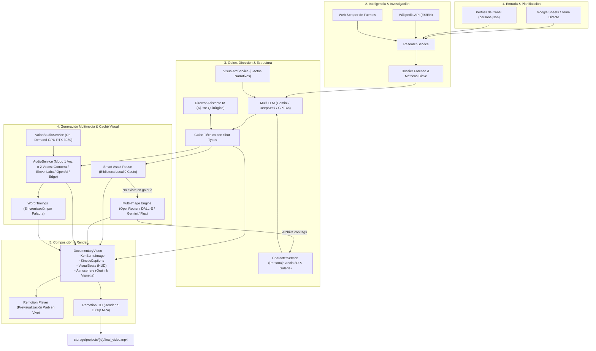

# 🎬 Videos_Automaticos (Studio Automation Pipeline)

> **Pipeline Full-Stack de Producción Automatizada de Videos Documentales Cinematográficos**  
> Impulsado por **Remotion**, **Multi-LLM** (Google GenAI, OpenAI, DeepSeek, OpenRouter), **Multi-TTS** (VoiceStudio Local RTX 3080, ElevenLabs, OpenAI, Microsoft Edge Neural) y **Multi-Engine Visual** (OpenRouter Gemini Flash Image, DALL-E 3, Google Gemini Image, Flux).

---

## 📌 Tabla de Contenidos

- [Descripción General](#-descripción-general)
- [Arquitectura del Sistema](#-arquitectura-del-sistema)
- [Características Principales](#-características-principales)
  - [1. Canales y Personalidades (`ChannelPersona`)](#1-canales-y-personalidades-channelpersona)
  - [2. Motor de Investigación Profunda (`ResearchService`)](#2-motor-de-investigación-profunda-researchservice)
  - [3. Arco Emocional y Fotometría en 6 Actos (`VisualArcService`)](#3-arco-emocional-y-fotometría-en-6-actos-visualarcservice)
  - [4. Biblioteca de Personajes, Galería Permanente y Reutilización Inteligente (`CharacterService`)](#4-biblioteca-de-personajes-galería-permanente-y-reutilización-inteligente-characterservice)
  - [5. Director Asistente con IA (`ScriptService.adjustWithAI`)](#5-director-asistente-con-ia-scriptserviceadjustwithai)
  - [6. Síntesis de Voz Multi-Motor, Modo Dual y Subtítulos Cinéticos (`AudioService` & `VoiceStudioService`)](#6-síntesis-de-voz-multi-motor-modo-dual-y-subtítulos-cinéticos-audioservice--voicestudioservice)
  - [7. Composición y Renderizado en Remotion](#7-composición-y-renderizado-en-remotion)
  - [8. Panel de Control y Estudio Web Interactivo](#8-panel-de-control-y-estudio-web-interactivo)
- [Estructura del Proyecto](#-estructura-del-proyecto)
- [Requisitos Previos e Instalación](#-requisitos-previos-e-instalación)
- [Variables de Entorno (`.env`)](#-variables-de-entorno-env)
- [Comandos de Ejecución](#-comandos-de-ejecución)
- [Flujo de Trabajo del Pipeline](#-flujo-de-trabajo-del-pipeline)
- [Referencia de API del Servidor](#-referencia-de-api-del-servidor)
- [Licencia](#-licencia)

---

## 🚀 Descripción General

**Videos_Automaticos** es una plataforma end-to-end de generación, dirección asistida y renderizado de videos documentales en formato 16:9 (1080p). Permite operar en dos modalidades complementarias:

1. **Modo Estudio Web Interactivo (`npm start`)**: Interfaz gráfica completa en React + Vite conectada al servidor Express para investigar casos, editar guiones escena por escena, aplicar ajustes quirúrgicos con un **Director Asistente de IA**, reutilizar activos visuales de la biblioteca a costo cero, alternar entre 1 o 2 narradores, gestionar el ciclo de vida del servidor local de voz en GPU (RTX 3080) y bifurcar proyectos (*Fork de Voz* o *Fork de Guion*).
2. **Modo Autónomo por Lotes (`npm run pipeline:auto`)**: Lee casos aprobados desde **Google Sheets**, investiga hechos verificables, redacta el guion estructurado en 6 actos cinematográficos, vincula el personaje ancla, genera imágenes consistentes, sintetiza la locución con sincronización palabra por palabra y deja el proyecto listo para renderizar en MP4.

---

## 🏗 Arquitectura del Sistema



---

## ✨ Características Principales

### 1. Canales y Personalidades (`ChannelPersona`)
Soporte multi-canal desacoplado ubicado en `channels/`:
- **`tech_scandals`**: Documentales forenses sobre caídas de gigantes tecnológicos, dramas de Silicon Valley, fraudes y controversias empresariales.
- **`ancient_lives`**: Biografías y crónicas históricas épicas de civilizaciones antiguas.

Cada canal define su arquetipo narrativo, ritmo objetivo de palabras por minuto (WPM), frases insignia (*signature cues*), vocabulario prohibido y estilo visual.

### 2. Motor de Investigación Profunda (`ResearchService`)
Antes de redactar el guion, el sistema extrae hechos rigurosos:
- **Scraping automático** de artículos, post-mortems y enlaces de referencia.
- **Consultas a Wikipedia** en español e inglés para verificar cronologías.
- **Dossier Forense Estructurado**: Perfil psicológico del protagonista, fuerza antagonista, analogía para conceptos técnicos complejos, cronología de eventos, cifras exactas (*hard numbers*) y pruebas irrefutables (*smoking guns*).

### 3. Arco Emocional y Fotometría en 6 Actos (`VisualArcService`)
La cinematografía sigue un arco dramático estricto de 6 actos:
1. **Acto I (El Espejismo en la Cima)**: *Hook / Clímax* — Iluminación cálida, sensación de invencibilidad y éxito.
2. **Acto II (Expediente del Protagonista)**: *Origen & Ascenso* — Retrato íntimo, luz natural volumétrica.
3. **Acto III (La Fuerza en la Sombra)**: *Antagonista & Rival* — Iluminación lateral en claroscuro, tensión creciente.
4. **Acto IV (Paréntesis Maestro)**: *Explicación del Mecanismo Oculto* — Diagramas conceptuales y analogías visuales.
5. **Acto V (Punto de Quiebre)**: *Colapso & Crisis* — Tonos fríos, luces de emergencia carmesí, sombras profundas.
6. **Acto VI (Veredicto Final)**: *Cenizas del Imperio* — Luz de luna plateada, melancolía y lecciones forenses.

Cada escena recibe dinámicamente su encuadre (`shot_type`): `character_closeup`, `environment_wide`, `object_detail`, `concept_diagram`, `antagonist_shot` o `symbolic_silhouette`.

### 4. Biblioteca de Personajes, Galería Permanente y Reutilización Inteligente (`CharacterService`)
- Almacenamiento JSON persistente por canal (`channels/<canal>/characters/`) y activos en `channels/<canal>/characters/assets/`.
- Generación de **Retrato Oficial 3D** (estilo Pixar/Arcane cinematográfico) o subida de imagen propia en PNG/JPG/WebP.
- **Galería Permanente Etiquetada**: Cada imagen generada o subida se archiva automáticamente con metadatos de lugar/entorno (`placeOrEnvironment`), tipo de plano (`shotType`), empresa y etiquetas (`tags`).
- **Reutilización Inteligente (`smartReuseImages`)**: Antes de gastar créditos de IA en una escena, el sistema busca coincidencias en la galería del personaje o canal; también permite seleccionar cualquier imagen de la biblioteca con 1 clic (0 costo, 0 espera).

### 5. Director Asistente con IA (`ScriptService.adjustWithAI`)
- Permite dar instrucciones en lenguaje natural sobre una escena específica o sobre todo el guion (ej. *"Haz más dramático el cierre del Acto V"*, *"Cambia el entorno de la escena 3 a una sala de servidores oscura"*).
- Opción de **regenerar automáticamente imagen y/o audio** únicamente en las escenas que hayan sido modificadas por la instrucción.

### 6. Síntesis de Voz Multi-Motor, Modo Dual y Subtítulos Cinéticos (`AudioService` & `VoiceStudioService`)
- **VoiceStudio Local (Gomorra en GPU RTX 3080)**:
  - Gestión automática bajo demanda o control manual desde la UI (`Iniciar / Detener VoiceStudio`) para liberar VRAM cuando no se utiliza.
- **Modo 1 Voz vs. 2 Voces (`single` / `dual`)**:
  - Permite alternar entre un narrador único o dos voces intercaladas por rol de escena (`primaryVoice` y `secondaryVoice`, ej. `gomorra` + `demo0001`).
- **Motores Cloud y Respaldo**:
  - **ElevenLabs Cloud** (*Multilingual v2*), **OpenAI TTS-1** y **Microsoft Edge Neural** (gratuito).
- **Subtítulos Cinéticos (`KineticCaptions`)**: Timestamps exactos por palabra (`wordTimings`) renderizados con efecto karaoke y resplandor sincronizado.

### 7. Composición y Renderizado en Remotion
- **Movimiento de Cámara Ken Burns (`KenBurnsImage`)**: Interpolación suave por frame (`zoom_in`, `zoom_out`, `pan_left`, `pan_right`, `static`).
- **Visual Beats (`VisualBeats`)**: HUD forense con badges animados por acto y métricas clave flotantes (`highlight_metric` y `highlight_label`).
- **Atmósfera Cinematográfica (`Atmosphere`)**: Grano de película (*film grain*), viñeta y barras panorámicas.
- **Exportación MP4**: Renderizado H.264/AAC a 1080p vía Remotion CLI (`storage/projects/<id>/final_video.mp4` y copia rápida en `out/DocumentaryVideo.mp4`).

### 8. Panel de Control y Estudio Web Interactivo
- Previsualizador en vivo con `@remotion/player`.
- Edición de voz en off, prompts visuales, cámara y métricas clave en tiempo real.
- **Fork de Voz** y **Fork de Guion** para crear variaciones de un proyecto sin repetir costos.

---

## 📁 Estructura del Proyecto

```plaintext
.
├── channels/                          # Canales, perfiles de marca y activos
│   ├── ancient_lives/                 # Canal de historia antigua
│   │   ├── characters/                # Biblioteca de personajes y retratos
│   │   └── persona.json               # Configuración de voz, tono y estilo
│   └── tech_scandals/                 # Canal de escándalos tecnológicos
│       ├── characters/                # Perfiles JSON + carpeta assets/
│       └── persona.json
│
├── pipeline/                          # Automatización en lote
│   └── batch_runner.ts                # Ejecutor autónomo integrado con Sheets
│
├── server/                            # Backend en Express + TypeScript
│   ├── index.ts                       # Rutas de la API REST y orquestación
│   ├── scripts/
│   │   ├── start-audio.ts             # Script CLI para iniciar VoiceStudio GPU
│   │   └── stop-audio.ts              # Script CLI para detener VoiceStudio GPU
│   └── services/
│       ├── audioService.ts            # VoiceStudio / ElevenLabs / Edge / OpenAI
│       ├── characterService.ts        # Personajes, galería y reutilización inteligente
│       ├── imageService.ts            # Generación OpenRouter / DALL-E / Gemini / Flux
│       ├── personaService.ts          # Carga de perfiles de canal
│       ├── projectService.ts          # CRUD, Forks y persistencia de proyectos
│       ├── researchService.ts         # Scraper, Wikipedia y Dossier Forense
│       ├── scriptService.ts           # Multi-LLM, traducción y Director Asistente IA
│       ├── sheetsService.ts           # Integración con Google Sheets
│       ├── visualArcService.ts        # Reglas fotométricas y arco en 6 actos
│       └── voiceStudioService.ts      # Control de ciclo de vida de VoiceStudio local
│
├── src/                               # Frontend React y Motor Remotion
│   ├── App.tsx                        # Interfaz de usuario del Estudio Web
│   ├── main.tsx                       # Entrada de React
│   ├── types/
│   │   └── index.ts                   # Interfaces TypeScript del sistema
│   └── remotion/                      # Componentes de video Remotion
│       ├── Atmosphere.tsx             # Grano de película y viñeta
│       ├── DocumentaryVideo.tsx       # Composición maestra
│       ├── index.ts                   # Registro de composiciones
│       ├── KenBurnsImage.tsx          # Cámara cinemática y paneos
│       ├── KineticCaptions.tsx        # Subtítulos palabra por palabra
│       ├── Root.tsx                   # Remotion Root
│       └── VisualBeats.tsx            # HUD con métricas y badges de actos
│
├── storage/projects/                  # Almacenamiento local de proyectos (ignorado en Git)
├── out/                               # Salida rápida de videos renderizados (ignorado en Git)
├── start.sh                           # Lanzador unificado (Backend + Frontend + Audio opcional)
├── package.json
├── tailwind.config.js
├── vite.config.ts
└── README.md
```

---

## 🛠 Requisitos Previos e Instalación

### Requisitos
- **Node.js**: v18.0.0 o superior (recomendado v20+).
- **npm** o **pnpm**.
- **FFmpeg**: Necesario para el renderizado de video en Remotion y procesamiento de audio.
- *(Opcional)* Servidor local **VoiceStudio** en GPU Nvidia (puerto `8000`) para síntesis de voz local sin costo por token.

### Pasos de Instalación

1. **Clonar el repositorio:**
   ```bash
   git clone https://github.com/Jchorestrepo/Videos_Automaticos.git
   cd Videos_Automaticos
   ```

2. **Instalar dependencias:**
   ```bash
   npm install
   ```

3. **Configurar variables de entorno:**
   ```bash
   cp .env.example .env
   ```

---

## 🔑 Variables de Entorno (`.env`)

Configura en `.env` las claves de los proveedores que desees utilizar:

```env
# 1. OpenAI (DALL-E 3 / gpt-image-1-mini + GPT-4o + TTS-1)
OPENAI_API_KEY=sk-...

# 2. OpenRouter (Gemini 3.1 Flash Image, Flux, Claude, DeepSeek)
OPENROUTER_API_KEY=sk-or-v1-...

# 3. DeepSeek (Guiones económicos de alto razonamiento forense)
DEEPSEEK_API_KEY=sk-...

# 4. Google Gemini API
GEMINI_API_KEY=...

# 5. ElevenLabs (Locución en inglés/español)
ELEVENLABS_API_KEY=...

# 6. Configuración de Puertos
PORT=3001
VITE_PORT=5173
```

---

## 💻 Comandos de Ejecución

| Comando | Descripción |
| :--- | :--- |
| `npm start` | **Recomendado:** Ejecuta `./start.sh` levantando Backend (`:3001`) y Frontend (`:5173`) juntos. VoiceStudio arranca bajo demanda. |
| `npm run dev:all` | Ejecuta `./start.sh --with-audio`, pre-arrancando también el servidor local VoiceStudio en la GPU RTX 3080. |
| `npm run audio:start` | Inicia manualmente el servidor local de voz VoiceStudio. |
| `npm run audio:stop` | Detiene el servidor local VoiceStudio y libera la VRAM de la GPU. |
| `npm run dev` | Inicia únicamente el frontend de Vite en `http://localhost:5173`. |
| `npm run server` | Inicia únicamente el servidor backend Express en `http://localhost:3001`. |
| `npm run studio` | Abre **Remotion Studio** para inspeccionar la línea de tiempo interactiva. |
| `npm run render` | Renderiza la composición directamente desde la terminal con Remotion CLI. |
| `npm run pipeline:auto` | Ejecuta el **Pipeline Autónomo por Lotes** leyendo casos aprobados desde Google Sheets. |

---

## 🔄 Flujo de Trabajo del Pipeline

### Vía A: Estudio Web Todo-en-Uno (Recomendado)
1. Inicia el estudio con un solo comando:
   ```bash
   npm start
   ```
2. Abre `http://localhost:5173` en tu navegador.
3. Selecciona el canal (`tech_scandals` o `ancient_lives`), elige un caso de **Google Sheets** o escribe un tema nuevo.
4. Genera el guion (incluye investigación forense automática y vinculación del personaje ancla).
5. Usa el **Director Asistente IA** si deseas pulir escenas, o selecciona/genera imágenes con **Reutilización Inteligente** activada.
6. Configura **1 Voz** o **2 Voces** y genera la locución sincronizada.
7. Previsualiza en el reproductor integrado y pulsa **Renderizar Video MP4**.

### Vía B: Modo Autónomo por Lotes (Batch Runner)
1. Marca `Aprobado? = TRUE` en una fila de la hoja de Google Sheets del canal.
2. Ejecuta:
   ```bash
   npm run pipeline:auto
   ```
   *(Opcional: añade `--final-en` para traducir a inglés documental y locutar con ElevenLabs)*:
   ```bash
   npm run pipeline:auto -- --final-en
   ```

---

## 📡 Referencia de API del Servidor

El servidor Express (`server/index.ts`) expone los siguientes endpoints principales:

### Estado y Servidor de Voz Local (VoiceStudio)
- `GET /api/config/status`: Estado de proveedores configurados, motores activos y voces disponibles.
- `GET /api/audio/voicestudio/status`: Estado en vivo del servidor local VoiceStudio (GPU RTX 3080).
- `POST /api/audio/voicestudio/start`: Inicia el servidor VoiceStudio bajo demanda.
- `POST /api/audio/voicestudio/stop`: Detiene el servidor VoiceStudio.

### Canales, Personajes y Galería
- `GET /api/channels` / `GET /api/channels/:id` / `POST /api/channels`: Gestión de canales y personalidades.
- `GET /api/characters/:channelId`: Lista la biblioteca de personajes y su galería de imágenes.
- `POST /api/characters/:channelId/draft`: Crea o vincula un borrador de personaje ancla.
- `POST /api/characters/:channelId/:characterId/generate-portrait`: Genera el retrato oficial 3D con IA.
- `POST /api/characters/:channelId/:characterId/upload-image`: Sube un retrato personalizado en base64.
- `POST /api/characters/:channelId/:characterId/set-canonical`: Define una imagen de la galería como retrato canónico del personaje.

### Proyectos y Bifurcaciones (Forks)
- `GET /api/projects` / `GET /api/projects/:id` / `DELETE /api/projects/:id`: Gestión de proyectos.
- `POST /api/projects/:id/fork-voice`: Crea un nuevo proyecto reutilizando los audios y timestamps existentes.
- `POST /api/projects/:id/fork-script`: Duplica únicamente el guion para explorar otra dirección visual o de voz.

### Guion, Imágenes, Audio y Render
- `POST /api/script/generate`: Investiga el tema y genera el guion estructurado en 6 actos.
- `POST /api/script/update`: Guarda cambios manuales en el guion.
- `POST /api/script/ai-adjust`: **Director Asistente IA** para modificar escenas o todo el guion con regeneración opcional de imagen/audio.
- `POST /api/script/translate-en`: Traduce y adapta el proyecto al inglés documental nativo.
- `POST /api/images/generate`: Genera imágenes por escena o lote completo con reutilización inteligente (`smartReuse`).
- `POST /api/projects/:id/scenes/:sceneId/upload-image`: Sube una imagen personalizada a una escena y la archiva en la galería del personaje.
- `POST /api/projects/:id/scenes/:sceneId/set-library-image`: Asigna instantáneamente una imagen existente de la biblioteca a una escena.
- `POST /api/project/voice-config`: Configura el modo de locución (`single` o `dual`) y los roles de voz por escena.
- `POST /api/audio/generate`: Sintetiza la voz por escena o proyecto completo con sincronización palabra por palabra.
- `POST /api/render`: Renderiza el video final en MP4 (1080p) usando Remotion CLI.

---

## 📄 Licencia

Este proyecto es privado y de uso interno. Todos los derechos reservados.
